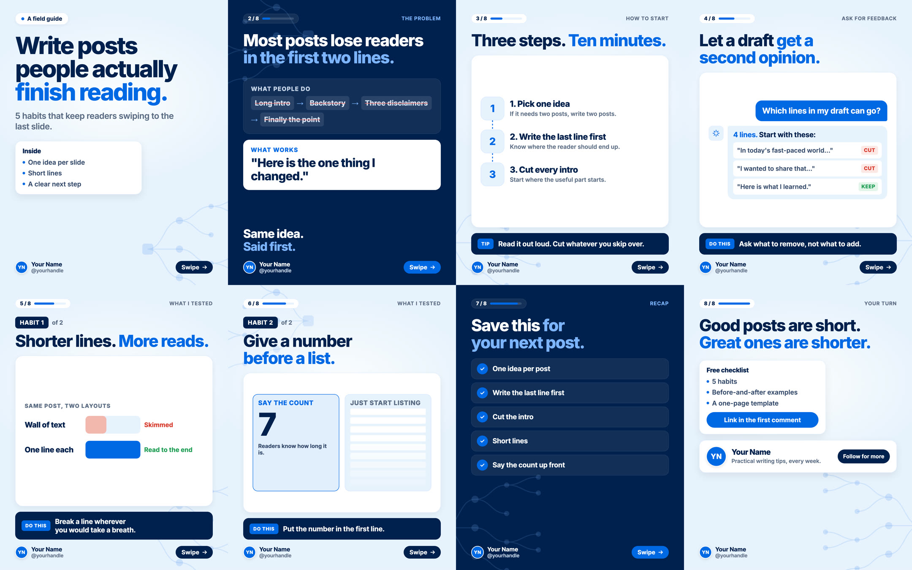

# linkedin-carousel-kit

Write a LinkedIn carousel in one small JS file. One command turns it into 1080x1350 PNGs and a PDF you can upload as a document post. It also checks every slide for text that runs off the edge or gets squeezed.



## What you get

- `slides.js`: your name, colours and slide text. This is the only file you need to edit.
- `index.html`: the template. It has 8 slide types and a progress bar, and draws its own background, so there are no image files to manage.
- `shot.cjs`: renders `out/01.png`, `out/02.png` and so on, plus `out/carousel.pdf`, and prints an overflow report.

## Quick start

You need [Node.js](https://nodejs.org) 18 or newer.

```bash
npm install
npm run build
```

Open `out/carousel.pdf` and upload it to LinkedIn as a document. The PNGs work for Instagram carousels or as single images.

You can also open `index.html` in a browser to see every slide stacked while you edit.

If you already have Chrome and don't want puppeteer to download its own copy:

```bash
PUPPETEER_SKIP_DOWNLOAD=1 npm install
CHROME_PATH="/path/to/chrome" npm run build
```

## Make it yours

At the top of `slides.js`:

```js
brand: {
  name: "Your Name",
  handle: "@yourhandle",
  photo: "",            // e.g. "assets/photo.jpg"; empty shows your initials
  colors: { bg, ink, accent, soft, muted, line },
},
```

Wrap words in `*stars*` to colour them with the accent colour, and use `<br>` to force a line break in a headline.

## Slide types

| type | what it shows | main fields |
|---|---|---|
| `cover` | big headline, subline, optional card | `chip`, `title`, `sub`, `card { title, items }` |
| `statement` | dark slide: crossed-out old way vs the new way | `title`, `before[]`, `after`, `punch` |
| `steps` | numbered steps joined by a dotted line | `title`, `steps[{ title, text }]`, `tip` |
| `chat` | a question and an answer with result rows | `ask`, `lead`, `rows[{ text, value, pill }]`, `tip` |
| `bars` | two or more bars with a result each | `caption`, `bars[{ name, pct, result, good }]`, `tip` |
| `compare` | one big number vs a fading list | `left { label, value, note }`, `right { label }`, `tip` |
| `list` | dark recap with ticks | `title`, `items[]` |
| `cta` | last slide: card with a button and a follow box | `card { title, items, button }`, `follow { line, button }` |

Every slide except the cover can take a `tag` (top right). `bars` and `compare` can take a `label` and `of` (for example "HABIT 1", "of 2"). A `tip` is `{ label, text }` and shows as a dark strip under the card. Pill colours are `red`, `green` and `blue`.

To add a new slide type, add a function to the `render` object in `index.html`.

## The overflow check

After rendering, `shot.cjs` reports any slide where:

- the content is taller than the slide,
- the white card's content does not fit, or the card is squeezed too small,
- a headline runs past 3 lines,
- any text runs past the right edge.

If it prints `all slides fit`, you're done. If not, shorten the line it names.

## Tips

- LinkedIn shows document posts at 4:5, which is why the slides are 1080x1350.
- Keep it to 6 to 12 slides with one idea each.
- The PDF has selectable text. If you need a flat image-only PDF, upload the PNGs instead.

## Credits

- Font: [Inter](https://github.com/rsms/inter) by Rasmus Andersson, SIL Open Font License 1.1 (see `assets/fonts/OFL.txt`).
- Rendering: [Puppeteer](https://pptr.dev).

## License

MIT for the code and template (see `LICENSE`). The Inter font files keep their own OFL licence.
